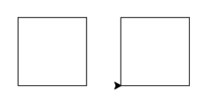
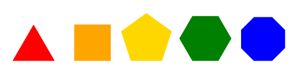
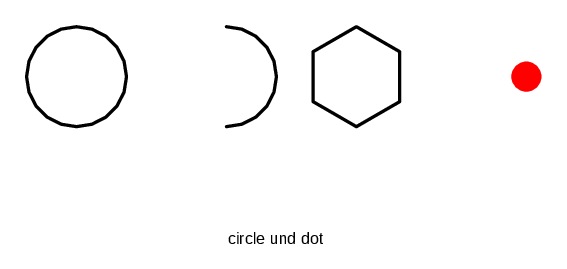
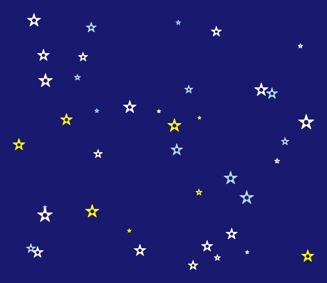
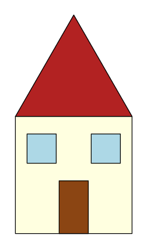
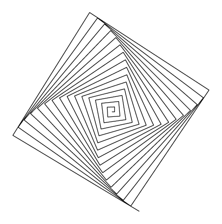
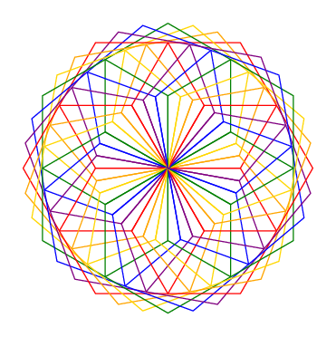

# Turtle-Grafik

## Inhaltsverzeichnis

* [Was ist die Turtle?](#was-ist-die-turtle)
* [Das erste Programm](#das-erste-programm)
* [Das Koordinatensystem](#das-koordinatensystem)
* [Bewegen und Drehen](#bewegen-und-drehen)
* [Wiederholungen mit Schleifen](#wiederholungen-mit-schleifen)
  * [Der Drehwinkel bei Vielecken](#der-drehwinkel-bei-vielecken)
* [Den Stift steuern](#den-stift-steuern)
* [Farben und Aussehen](#farben-und-aussehen)
  * [Formen ausfüllen](#formen-ausfüllen)
* [Eigene Funktionen](#eigene-funktionen)
* [Kreise, Punkte und Text](#kreise-punkte-und-text)
* [Zufall](#zufall)
* [Beispiele](#beispiele)
* [Alle Befehle auf einen Blick](#alle-befehle-auf-einen-blick)
* [Typische Fehler](#typische-fehler)
* [Übungsaufgaben](#übungsaufgaben)

## Was ist die Turtle?

Die Turtle (engl. für Schildkröte) ist eine kleine Figur, die einen Stift trägt und damit über den Bildschirm läuft. Wir geben ihr Befehle wie „gehe 100 Schritte vorwärts“ oder „drehe dich um 90° nach links“, und sie zeichnet dabei ihren Weg auf.

Die Idee stammt aus der Programmiersprache **Logo**, mit der schon in den 1960er-Jahren Kinder programmieren gelernt haben. In Python ist die Turtle bereits eingebaut: Wir müssen **nichts installieren**.

Mit der Turtle üben wir alles, was wir bisher gelernt haben, und sehen das Ergebnis sofort:

* **Befehle** der Reihe nach ausführen
* **Schleifen**, um Dinge zu wiederholen
* **Funktionen** mit Parametern, um Code wiederzuverwenden
* **Variablen** und **Zufall**

## Das erste Programm

Erzeuge eine neue Python-Datei und nenne sie zum Beispiel `zeichnen.py`.

> **Achtung:** Die Datei darf **nicht** `turtle.py` heißen! Sonst findet Python das echte Turtle-Modul nicht mehr und es kommt zu seltsamen Fehlermeldungen wie `AttributeError: module 'turtle' has no attribute 'Turtle'`.

Jedes Turtle-Programm hat denselben Aufbau:

```python
import turtle            # 1. Das Turtle-Modul laden

t = turtle.Turtle()      # 2. Eine Turtle erzeugen und in der Variable t speichern

t.forward(100)           # 3. Befehle an die Turtle schicken

turtle.done()            # 4. Das Fenster offen lassen
```

1. `import turtle` lädt das Modul, das alle Turtle-Befehle enthält.
2. `turtle.Turtle()` erzeugt eine neue Turtle. Wir speichern sie in der Variable `t`, damit wir nicht jedes Mal so viel schreiben müssen.
3. Mit `t.` und dem Namen des Befehls sagen wir der Turtle, was sie tun soll.
4. `turtle.done()` sorgt dafür, dass das Fenster offen bleibt, bis wir es selbst schließen. Ohne diese Zeile schließt sich das Fenster in manchen Programmen sofort wieder.

Wenn du das Programm startest, öffnet sich ein Fenster. Die Turtle (ein kleiner Pfeil) startet in der Mitte und zeichnet eine Linie nach rechts.

## Das Koordinatensystem

Das Zeichenfenster ist ein Koordinatensystem, so wie wir es aus Mathematik kennen:

* Der Punkt **(0, 0)** liegt genau in der **Mitte** des Fensters.
* Die **x-Achse** zeigt nach rechts, die **y-Achse** nach oben.
* Negative x-Werte liegen links, negative y-Werte unten.
* Am Anfang schaut die Turtle nach **rechts (Osten)**. Das entspricht der Richtung 0°.

```
                 y
                 ▲
                 │   (100, 50)
                 │      •
                 │
  ───────────────┼───────────────▶ x
                 │(0, 0)
                 │
     •           │
 (-150, -80)     │
```

Die Richtungen der Turtle werden in Grad angegeben: 0° ist rechts, 90° ist oben, 180° ist links und 270° ist unten.

## Bewegen und Drehen

Die vier wichtigsten Befehle sind:

| Befehl | Bedeutung |
| --- | --- |
| `t.forward(strecke)` | so viele Schritte **vorwärts** gehen |
| `t.back(strecke)` | so viele Schritte **rückwärts** gehen |
| `t.left(winkel)` | um so viel Grad nach **links** drehen |
| `t.right(winkel)` | um so viel Grad nach **rechts** drehen |

Die Turtle dreht sich immer **auf der Stelle**. Die Drehung ist relativ zu ihrer aktuellen Blickrichtung: `t.left(90)` heißt „dreh dich von dort, wo du gerade hinschaust, um 90° nach links“.

Damit können wir schon ein Quadrat zeichnen:

```python
import turtle

t = turtle.Turtle()

t.forward(100)
t.left(90)
t.forward(100)
t.left(90)
t.forward(100)
t.left(90)
t.forward(100)
t.left(90)

turtle.done()
```



Am Ende steht die Turtle wieder am Startpunkt und schaut wieder nach rechts. Das ist praktisch, denn so wissen wir genau, wo sie nach dem Zeichnen ist.

## Wiederholungen mit Schleifen

Im Quadrat oben wiederholen sich `t.forward(100)` und `t.left(90)` genau viermal. Statt den Code viermal zu schreiben, verwenden wir eine `for`-Schleife:

```python
for i in range(4):
    t.forward(100)
    t.left(90)
```

Das Ergebnis ist genau dasselbe Quadrat, aber der Code ist viel kürzer. Wenn wir die Seitenlänge ändern wollen, müssen wir das nur an **einer** Stelle tun.

Ein gleichseitiges Dreieck funktioniert genauso, nur mit 3 Wiederholungen:

```python
for i in range(3):
    t.forward(150)
    t.left(120)
```

### Der Drehwinkel bei Vielecken

Beim Dreieck drehen sich viele zuerst um 60°, weil die Innenwinkel eines gleichseitigen Dreiecks 60° groß sind. Das Ergebnis ist aber kein Dreieck!

Der Grund: Die Turtle dreht sich nicht um den **Innenwinkel**, sondern um den **Außenwinkel**. Das ist der Winkel, um den sie von ihrer bisherigen Laufrichtung abweichen muss. Beim Dreieck sind das 180° − 60° = **120°**.

Nach einem vollständigen Umlauf hat sich die Turtle genau **einmal im Kreis** gedreht, also um 360°. Deshalb gilt für jedes regelmäßige Vieleck:

**Drehwinkel = 360° : Anzahl der Ecken**

| Vieleck | Ecken | Drehwinkel |
| --- | --- | --- |
| Dreieck | 3 | 120° |
| Quadrat | 4 | 90° |
| Fünfeck | 5 | 72° |
| Sechseck | 6 | 60° |
| Achteck | 8 | 45° |
| Zehneck | 10 | 36° |
| n-Eck | n | 360° : n |

## Den Stift steuern

Normalerweise zeichnet die Turtle bei jeder Bewegung eine Linie. Oft wollen wir sie aber an eine andere Stelle bringen, **ohne** zu zeichnen. Dafür heben wir den Stift an:

| Befehl | Bedeutung |
| --- | --- |
| `t.penup()` | Stift **heben**: Ab jetzt wird nicht mehr gezeichnet. |
| `t.pendown()` | Stift **absetzen**: Ab jetzt wird wieder gezeichnet. |
| `t.goto(x, y)` | direkt zum Punkt (x, y) gehen |
| `t.home()` | zurück zur Mitte (0, 0), Blick nach rechts |
| `t.setheading(winkel)` | in eine bestimmte Richtung schauen (0 = rechts, 90 = oben, …) |

```python
t.penup()          # Stift heben
t.goto(-200, 50)   # zum Punkt (-200, 50) springen
t.pendown()        # Stift wieder absetzen
t.forward(100)     # hier wird wieder gezeichnet
```

> **Wichtig:** `goto` ändert die Blickrichtung der Turtle **nicht**. Sie schaut danach in dieselbe Richtung wie vorher.

## Farben und Aussehen

| Befehl | Bedeutung |
| --- | --- |
| `t.color("red")` | Stift- und Füllfarbe auf Rot setzen |
| `t.color("black", "yellow")` | Stiftfarbe Schwarz, Füllfarbe Gelb |
| `t.pensize(5)` | Strichdicke 5 |
| `t.speed(0)` | Tempo: 1 = langsam, 10 = schnell, **0 = am schnellsten** |
| `t.shape("turtle")` | die Turtle wirklich als Schildkröte anzeigen (auch: `"arrow"`, `"circle"`, `"square"`, `"triangle"`) |
| `t.hideturtle()` | die Turtle verstecken, damit nur die Zeichnung zu sehen ist |
| `t.showturtle()` | die Turtle wieder anzeigen |
| `turtle.bgcolor("lightblue")` | Hintergrundfarbe des ganzen Fensters |

Farben können als englische Namen angegeben werden, zum Beispiel `"red"`, `"green"`, `"blue"`, `"yellow"`, `"orange"`, `"purple"`, `"pink"`, `"brown"`, `"gray"`, `"black"`, `"white"`, `"gold"` oder `"lightblue"`. Es funktionieren auch Hex-Codes wie `"#ff8800"`.

### Formen ausfüllen

Um eine Form auszufüllen, schreiben wir den Zeichencode zwischen `t.begin_fill()` und `t.end_fill()`:

```python
t.color("black", "gold")   # schwarzer Rand, goldene Füllung
t.begin_fill()
for i in range(5):
    t.forward(200)
    t.right(144)
t.end_fill()
```


Erst bei `t.end_fill()` wird die Fläche gefüllt. Am besten endet die Turtle dabei wieder an ihrem Startpunkt, damit die Form geschlossen ist.

## Eigene Funktionen

Sobald wir mehrere Vielecke zeichnen wollen, lohnt sich eine eigene Funktion. Die Anzahl der Ecken und die Seitenlänge übergeben wir als **Parameter**:

```python
def vieleck(ecken, laenge):
    for i in range(ecken):
        t.forward(laenge)
        t.left(360 / ecken)

vieleck(3, 100)   # Dreieck
vieleck(4, 100)   # Quadrat
vieleck(6, 60)    # Sechseck
```

Mit einem weiteren Parameter für die Farbe und einer Hilfsfunktion `springe` zum Versetzen der Turtle wird unser Code noch übersichtlicher:

```python
def springe(x, y):
    t.penup()
    t.goto(x, y)
    t.pendown()


def vieleck(ecken, laenge, farbe):
    t.color(farbe)
    t.begin_fill()
    for i in range(ecken):
        t.forward(laenge)
        t.left(360 / ecken)
    t.end_fill()


springe(-250, 0)
vieleck(3, 80, "red")

springe(-130, 0)
vieleck(4, 70, "orange")

springe(-20, 0)
vieleck(5, 60, "gold")

springe(100, 0)
vieleck(6, 50, "green")

springe(220, 0)
vieleck(8, 35, "blue")
```



**Tipp:** Was passiert bei `vieleck(36, 10)` oder `vieleck(360, 1)`? Mit sehr vielen, sehr kurzen Seiten sieht das Vieleck aus wie ein Kreis. Genau so zeichnet auch der Computer Kreise!

## Kreise, Punkte und Text

Für Kreise gibt es einen eigenen Befehl:

| Befehl | Bedeutung |
| --- | --- |
| `t.circle(50)` | Kreis mit Radius 50 |
| `t.circle(50, 180)` | nur ein Bogen von 180° (Halbkreis) |
| `t.circle(50, steps=6)` | Vieleck mit 6 Ecken, das in einen Kreis mit Radius 50 passt |
| `t.dot(30, "red")` | gefüllter Punkt mit Durchmesser 30 |
| `t.write("Hallo")` | Text an die aktuelle Position schreiben |

Wichtig bei `circle`: Der Kreis wird **links** von der Turtle gezeichnet. Die Turtle läuft am Rand entlang, der Mittelpunkt liegt also nicht dort, wo die Turtle startet, sondern 50 Schritte links von ihr.

Bei `write` kann man auch die Ausrichtung und die Schrift angeben:

```python
t.write("Hallo!", align="center", font=("Arial", 24, "bold"))
```



## Zufall

Mit dem Modul `random` können wir die Turtle Dinge zufällig zeichnen lassen. Jedes Mal, wenn das Programm läuft, entsteht ein anderes Bild.

| Befehl | Bedeutung |
| --- | --- |
| `random.randint(1, 10)` | zufällige ganze Zahl von 1 bis 10 (beide inklusive) |
| `random.choice(liste)` | zufälliges Element aus einer Liste |

```python
import turtle
import random

turtle.bgcolor("midnightblue")

t = turtle.Turtle()
t.speed(0)
t.hideturtle()

farben = ["white", "yellow", "lightyellow", "lightblue"]


def stern(groesse, farbe):
    t.color(farbe)
    t.begin_fill()
    for i in range(5):
        t.forward(groesse)
        t.right(144)
    t.end_fill()


for i in range(40):
    x = random.randint(-300, 280)
    y = random.randint(-250, 250)
    t.penup()
    t.goto(x, y)
    t.pendown()
    stern(random.randint(5, 30), random.choice(farben))

turtle.done()
```



## Beispiele

Alle Beispiele findest du auch als fertige Dateien im Ordner [beispiele/turtle](https://github.com/benschi11/python/tree/master/beispiele/turtle).

### Haus

Ein Haus aus einem Quadrat, einem Dreieck und mehreren Rechtecken. Jede Form hat eine eigene Funktion. `springe` und `vieleck` sind wie oben definiert, nur mit `t.color("black", farbe)`, damit jede Form einen schwarzen Rand bekommt. ([03Haus.py](https://github.com/benschi11/python/blob/master/beispiele/turtle/03Haus.py))

```python
def rechteck(breite, hoehe, farbe):
    t.color("black", farbe)
    t.begin_fill()
    for i in range(2):
        t.forward(breite)
        t.left(90)
        t.forward(hoehe)
        t.left(90)
    t.end_fill()


# Wand
springe(-100, -100)
vieleck(4, 200, "lightyellow")

# Dach
springe(-100, 100)
vieleck(3, 200, "firebrick")

# Tür
springe(-25, -100)
rechteck(50, 90, "saddlebrown")

# Fenster
springe(-80, 20)
rechteck(50, 50, "lightblue")
springe(30, 20)
rechteck(50, 50, "lightblue")
```



### Stern

Warum entsteht gerade bei 144° ein Stern? Die Turtle dreht sich insgesamt um 5 · 144° = 720°, also **zweimal** im Kreis. Dabei kreuzen sich die Linien. ([04Stern.py](https://github.com/benschi11/python/blob/master/beispiele/turtle/04Stern.py))

```python
for i in range(5):
    t.forward(200)
    t.right(144)
```

### Spirale

Hier verwenden wir eine Variable `laenge`, die bei jedem Durchlauf größer wird. Weil sich die Turtle um 91° statt um 90° dreht, verdreht sich die Spirale ein wenig. ([05Spirale.py](https://github.com/benschi11/python/blob/master/beispiele/turtle/05Spirale.py))

```python
laenge = 5
for i in range(60):
    t.forward(laenge)
    t.left(91)
    laenge = laenge + 5
```



Probiere auch andere Winkel aus, zum Beispiel 90°, 121° oder 144°!

### Blume

Eine Schleife in einer Schleife: 36 Sechsecke, nach jedem dreht sich die Turtle um 10°. Die Farben werden aus einer Liste genommen. `i % len(farben)` sorgt dafür, dass nach der letzten Farbe wieder die erste kommt. ([06Blume.py](https://github.com/benschi11/python/blob/master/beispiele/turtle/06Blume.py))

```python
farben = ["red", "orange", "gold", "green", "blue", "purple"]

for i in range(36):
    t.color(farben[i % len(farben)])
    vieleck(6, 80)
    t.left(10)
```



## Alle Befehle auf einen Blick

| Befehl | Bedeutung |
| --- | --- |
| `import turtle` | Turtle-Modul laden |
| `t = turtle.Turtle()` | neue Turtle erzeugen |
| `turtle.done()` | Fenster offen lassen (immer am Ende) |
| `t.forward(s)` / `t.back(s)` | s Schritte vor / zurück |
| `t.left(w)` / `t.right(w)` | um w Grad nach links / rechts drehen |
| `t.penup()` / `t.pendown()` | Stift heben / absetzen |
| `t.goto(x, y)` | zum Punkt (x, y) gehen |
| `t.home()` | zurück zur Mitte |
| `t.setheading(w)` | in Richtung w schauen |
| `t.circle(r)` | Kreis mit Radius r |
| `t.dot(d, farbe)` | Punkt mit Durchmesser d |
| `t.write(text)` | Text schreiben |
| `t.color(farbe)` | Farbe setzen |
| `t.color(stift, fuellung)` | Stift- und Füllfarbe setzen |
| `t.pensize(d)` | Strichdicke |
| `t.begin_fill()` / `t.end_fill()` | Form ausfüllen |
| `t.speed(n)` | Tempo (0 = am schnellsten) |
| `t.shape("turtle")` | Aussehen der Turtle |
| `t.hideturtle()` / `t.showturtle()` | Turtle verstecken / anzeigen |
| `turtle.bgcolor(farbe)` | Hintergrundfarbe |
| `t.xcor()` / `t.ycor()` | aktuelle x- / y-Koordinate |
| `t.heading()` | aktuelle Blickrichtung in Grad |
| `t.clear()` | Zeichnung löschen |

Die vollständige Dokumentation findest du in der [offiziellen Python-Dokumentation](https://docs.python.org/3/library/turtle.html).

## Typische Fehler

| Problem | Ursache und Lösung |
| --- | --- |
| `AttributeError: module 'turtle' has no attribute 'Turtle'` | Die eigene Datei heißt `turtle.py`. Datei umbenennen und eine eventuell vorhandene Datei `turtle.pyc` bzw. den Ordner `__pycache__` löschen. |
| Das Fenster geht sofort wieder zu. | `turtle.done()` fehlt am Ende des Programms. |
| `NameError: name 't' is not defined` | Die Zeile `t = turtle.Turtle()` fehlt oder steht weiter unten als der erste Befehl. |
| Die Form ist nicht geschlossen. | Falscher Drehwinkel: Er muss 360° : Anzahl der Ecken sein. |
| Beim Versetzen entsteht eine Linie. | Vor `goto` fehlt `t.penup()`. |
| Nach dem Versetzen wird nichts mehr gezeichnet. | Nach `goto` fehlt `t.pendown()`. |
| Das Zeichnen dauert ewig. | `t.speed(0)` am Anfang einfügen. |
| `TypeError: forward() missing 1 required positional argument` | Die Klammer ist leer: `t.forward()` braucht eine Zahl, z. B. `t.forward(100)`. |
| Turtle-Programm läuft im Online-Editor nicht | Die Turtle braucht ein Fenster. Verwende Thonny, IDLE oder VS Code auf dem eigenen Gerät, oder einen Online-Editor mit Turtle-Unterstützung wie [trinket.io](https://trinket.io/turtle). |

## Übungsaufgaben

1. Zeichne ein Rechteck, das 200 Schritte breit und 80 Schritte hoch ist.
2. Zeichne ein gleichseitiges Dreieck, ein Sechseck und ein Achteck jeweils mit einer `for`-Schleife.
3. Schreibe eine Funktion `vieleck(ecken, laenge, farbe)` und zeichne damit fünf verschiedene Vielecke nebeneinander.
4. Zeichne ein Haus mit Fenstern und Tür. Verwende für jede Form eine eigene Funktion.
5. Zeichne einen Stern. Erkläre, warum der Winkel 144° sein muss.
6. Zeichne eine Spirale und probiere verschiedene Drehwinkel aus.
7. Zeichne eine Blume aus gedrehten Vielecken in mehreren Farben.
8. Zeichne einen zufälligen Sternenhimmel mit `random`.
9. **Haus vom Nikolaus:** Zeichne das „Haus vom Nikolaus“ in einem Zug, also ohne `penup()`. Verwende `goto` mit den Koordinaten der Eckpunkte.
10. **Freie Aufgabe:** Gestalte ein eigenes Bild (Landschaft, Auto, Roboter, …). Jede Form bekommt eine eigene Funktion mit Parametern für Position, Größe und Farbe.
